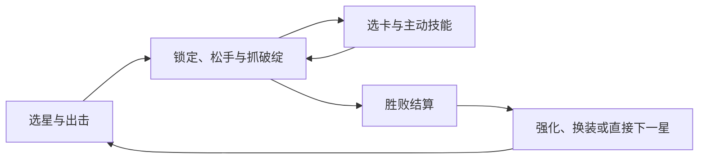

# 立项说明

2026-11-13 补录。早期动机来自 Symbol 的作品集访谈，版本范围依据当前项目规则。玩家画像与测试判断仍是待验证假设。

## 游戏简介

《子时已到》是一款竖屏巡夜动作游戏。角色自动攻击，玩家通过长按进入子弹时间并锁定幽灵，根据敌方威胁、耐力与破绽选择齐射时机。正式 Unity 版本中，手动命中积累连击，连击补充超载热量，提升后续自动攻击的频率与弹数。

## 立项背景与设计目标

Symbol 最初想复现的是「锁住多个目标，一瞬间连续开火」的感受。早期飞鸟原型很快跑通了长按、锁定和松手，但自玩时暴露出一个问题：鸟只横穿场地，玩家大可以等更多目标出现再一起打。地鼠出入洞提供了可攻击的时间窗口，幽灵方向把显形、可锁和临近威胁放在同一个目标身上。几种鸟类攻击是当时讨论过的方向，实际完成范围以原型或回忆能确认的内容为准。 Symbol 作品集访谈

| 想让玩家感到什么 | 反复发生的决定 | 支撑的规则和反馈 |
| --- | --- | --- |
| 连续锁定的风险与收益 | 继续锁定，或优先处理逼近的目标 | 长按减速并消耗耐力，松手攻击已锁目标，敌人威胁继续变化 |
| 时机判断的收益反馈 | 等待破绽，或提前处理威胁 | 可锁状态与破绽提示，破绽命中增加连击收益，连击补充热量 |
| 局内火力成长 | 扩展可用能力，或强化已有能力 | 房间结束后的局内选卡、超载档位变化，以及主动技能的不同用途 |
| 永久成长反馈 | 直接挑战下一星，或先投入本次收益进行强化 | 结算展示到账资源，强化显示消耗和攻击变化，下一星应用升级结果 |

## 目标用户与体验假设

| 假设 | 先找谁验证 | 观察什么会改变判断 |
| --- | --- | --- |
| 接触过移动端轻动作游戏的人能自行理解一按一松 | 近期玩过竖屏动作或肉鸽、初次接触 Noon 的玩家 | 会长按却一直等自动开枪，或反复点按而没理解松手，优先检查教程和锁定反馈 |
| 可见威胁和限时破绽能制造不同的松手时机 | 同一批新玩家，补一组熟悉此类操作的玩家看上限 | 只在耐力用完时松手，或为了等更多敌人总是用同样节奏，检查窗口、威胁与反馈 |
| 玩家愿意把首通收益用于成长，再试一星 | 完成首星的玩家 | 看懂资源却找不到强化，优先改信息和跳转。强化后仍看不出收益，检查战斗与成长强度 |

项目有设计者自测、他人反馈的回忆和技术验证记录。当前材料中没有足以支持市场空白、用户分布、留存或付费结论的样本。下一次研究用[无指导试玩方案](../docs/noon-playtest.html)收集行为与原话，再决定最值得改的环节。

渠道与投入判断由 Symbol 在首轮可用性问题定位后决定是否启动。届时单独固定发行版本和渠道，查对应来源的新用户构成，观察进入教程、完成首星和再次出击的行为，再判断是否需要更长的留存及付费验证。

## 版本范围

| 版本 | 制作目标与已有入口 |
| --- | --- |
| Unity 海外 App | 首星教程包含三个房间；正式玩法采用破绽与超载机制，首通收益用于备战和再次出击。现有备战包含四级强化、十五套皮肤与永久技能成长。50 级强化树、碎片升星及商城奖池按后续规格推进。 战斗合并 · 备战预览 · 局外计划 |
| Cocos 国内小游戏 | 使用自身启动、战斗配置、触控和平台能力。Cocos 的三心、耐力、锁定及敌人规则按现行索引核对。 Cocos 战斗入口 |
| Unity 独立玩法试验 | 一个隔离场景验证教学、破绽、添柴、技能与 Boss 反制。可用新手路线、成型路线和 Boss 练习分别定位问题。 独立试玩 |

系统数值、商品和阶段安排继续从各版本维护文档读取。立项阶段先回答能否学会、能否做出有理由的选择、是否愿意再玩一局。

## Unity 系统概览

| 系统 | 玩家在这里决定什么 | 维护入口 |
| --- | --- | --- |
| 战斗与关卡 | 处理眼前威胁，还是等一个破绽；什么时候投入主动技能 | 正式战斗合并 · 正式数值 |
| 结算与强化 | 要不要把本次收益换成下一星可感知的攻击 | 首测范围与预算 · 备战预览 |
| 皮肤与技能 | 穿戴什么、如何获取；长期培养和局内选卡怎样互相补足 | 当前成长规则 · 局外后续规格 |
| 商城与体力 | 看清获得方式、消耗、到账和下一次出击的门槛 | [页面状态](../docs/noon-ui-flow.html) · 现有运行配置 · 发行交接 |

## 设计参考

| 游戏 | 对 Noon 的研究问题 | 当前用途与边界 |
| --- | --- | --- |
| 《弓箭传说》 | 怎样让玩家从章节、结算和永久成长回到下一次挑战 | Noon 早期拆解了入口与奖励去向。当前战斗仍围绕长按和松手时机。 项目参考记录 · [官方商店页](https://apps.apple.com/us/app/archero/id1453651052) |
| 《枪豆人》 | 同类弹体或敌人多次出现时，事件怎样保持可辨识 | 首批用来研究重复触发的反馈节奏。玩法为合作弹幕射击，Noon 的样件只检验重复齐射反馈。 [官方 Steam 页](https://store.steampowered.com/app/3003460/Bang_Bang_Barrage/?l=schinese) |
| 《塔塔冒险队》 | 养成页面中怎样让可点、禁用和奖励区有层级 | 首批用来观察宠物塔防的按钮和底板。对照点是阅读与反馈，具体材质做法待实机取证。 [官网](https://ttmxd.lilith.com/) |

对照项目的美术取证走规范初稿。玩家理解、复玩和市场判断走各自的样本与证据。 [项目计划](../docs/noon-project-plan.html)
