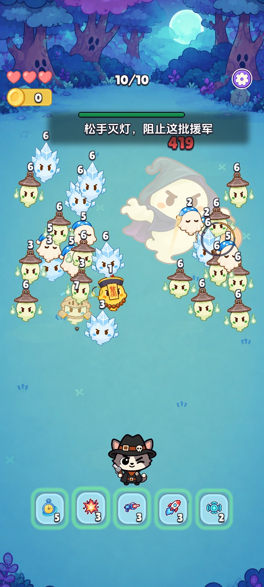

> 设计复盘 · 子时已到 · 整理于 2026-11-05
> 回看时段：2026.11.02–11.05

# 人物一定要动吗？我用十个房间重试子弹时间

对方问我，能不能让猫像《刀刀厨神》那样横着走。理由挺实际：这只猫一直站在原地，耐力不够时我也会频繁点屏幕打单发。做成一款需要重复玩的 App，靠长按、松手撑到后面，确实容易腻。

我一开始纠结按住屏幕拖动会不会和锁敌抢输入。再想一步，即使操作能兼容，横移也会改变我想让玩家练的东西。能走位以后，危险可以先靠躲开解决。原版最吸引我的时刻，是看见攻击快来了、按住放慢世界，然后决定现在开火，还是再赌一个目标。这个判断值得先保留。

## 先试自动支援，找出重复到底发生在哪儿

第一份可试玩对照用了七个房间。A 模式在松手时让炮台自动装填和攻击，B 模式保留纯手动。A 能给耐力恢复时的玩家一点喘息，聚焦期间炮台暂停，玩家需要决定什么时候接管。我随后要求再做的改动放进独立 Demo。这样能先换掉规则试一次，也能让主版本和局外成长继续按原来的节奏推进。

回看旧版，我卡住的是两头。耐力和锁敌数往上加，后段容易每轮按到底，一次把场面清掉。限制成长，又只是把前几关的操作多重复几遍。我想到《枪豆人》给我的启发是，一次射击可以改变下一次行动的条件。这里可以让手动齐射改变接下来几秒的自动火力，让等待、聚焦和释放彼此影响。

## 从一个能玩的小实验，到完整的十房 Demo

### 1. 先让短时机会和长齐射都有用

我提出把远程出手、即将虚化和短暂出现的奖励做成同一种可抓的机会，后来称为「破绽」。普通齐射命中能打断一下动作，抓到破绽才取消当次行动、给更明显的收益。讨论时我也想过要不要把残血击杀算成破绽。这样比较容易获得，但玩家可能只盯着残血，原本要看的出手时机就会变弱，实验把两件事分开。

### 2. 用看得懂的连击把两种攻击接起来

我觉得「连击值」要先懂换算才知道自己得了什么，就希望玩家继续看熟悉的连击。现在 Demo 里普通命中记 1，破绽命中记 2，齐射结束后统一结算超载。同档或低档不续时，升到更高一档才重新计时。超载会加快自动射击并增加单次弹数，普通单发仍然有自己的节奏。一次漂亮的齐射应该改变下一段战斗，尤其在后期自动弹幕已经很强的时候。

### 3. 后段要真有机会打出成型火力

最初的浏览器草模可以看出规则关系，但画面和操作太简陋。我希望直接用现成的 Unity 局内素材和版面做完整试玩。原版起步锁敌的手感已经可以，前几房应保留从单发起步的过程，最后几房再让玩家用成型构筑面对足够多的目标。Unity 版最终组织为一夜十个房间，并另设可直达最后三房的火力预设。预设方便反复试后段，前几房仍要靠自然路线检查。

独立 Demo 的成型路线实机。它从第八房开始，画面中的强化量属于展示预设。

### 4. 把点火做成玩家能追得上的一件事

最早飞回来的火种太像攻击弹，我后来改成让右上的连击数字自己沿弧线加速飞回，撞到猫身上时点火。火由小到大表达超载强度，随后逐渐熄灭来提示剩余时间。「超载」两个字只在点燃时弹出来。那几次迭代里，我反复在问同一个问题：玩家能不能只看场上的变化，就知道这轮齐射让接下来的火力变强了？

### 5. 主动技能要有值得留一留的用途

卡亮了能点这件事一开始很不明显。我要求保留纯图标和强化次数，用绿光、轻弹和径向冷却提示就绪。更难的是，主动和被动如果只是同一个技能多触发一次，玩家很容易全按。最终 Demo 给了五张卡。爆炸找成团区域，激光用多束贯穿不同路径，导弹追高危目标，脉冲主动扇形强推、被动近身小范围打断，屏息则给玩家争取一点重新锁敌的时间。哪些技能真正值得留到某个场面，要看实际玩起来怎么用。

### 6. 收紧成长，让回满和等破绽重新有代价

我曾希望红卡稀有地给到三路同时锁定。再试时，瞄准数量已经叠得很快，耐力也回得太快，操作又回到「按空，马上再按空」。最新候选收回到常驻最多两路，额外瞄准作为另一项少量成长；初始空条回满约 6.4 秒。看到接近 Boss 的展示配了 29 项强化时，我也希望减少每房停下来选卡的次数。十房自然路线现在安排 14 次选卡，多数有选卡的房间只给一两次，成型预设单独给 16 次。

### 7. 把怪群做出起伏，让画面还读得懂

我看到后段同屏像一直维持在最大数量，刚清一点马上补回来。想要的是清出一点空间，紧接着有一批幽灵突然进场，然后玩家在少量补充里扛过最紧的一段。现在用集中进场、承压和清理间奏组织，不显示第几波，也不要求清光才能进下一批。数量回落后可以观察下一批位置，耐力恢复才有使用价值。普通幽灵加入钻出和回稳动作，成批来时先看清进入，再看威胁。自动攻击也从只打地面敌人，改为能预测并拦截飞行弹体，仍保留已经手动锁好的目标。

最后几轮也改了危险的读法。后半程幽灵仍用固定体型。锁圈缩小，露出轮廓，破绽剩余时间放到头部一侧的小黄圈，快结束时更明显。单发要能感到震屏，连击和击破可以更强，但上限得明确，否则最忙的时候反而看不清破绽。选卡也从左上库存逐张飞出，玩家能知道这次弹窗消耗了哪张卡。

## 现在想继续看的问题

**连续打到第五、第六房，玩家有没有因为局面不同而换做法？** 同样是十四次选择，如果每局都把五张卡学齐，到最后可能仍是耐力满了按到底、卡一亮全按。当前想用同样的选卡预算，比较三张重点强化与五张全学。成团、分散、近身残敌和高血远程，应让范围、贯穿、控制或点杀在不同时间更值得留手。

到 11 月 5 日，独立 Demo 的规则和引擎验证已覆盖 13 组主流程与 28 条技能检查。固定策略和成型预设可以帮助检查边界。真实难度、连续复玩时的策略变化和手机触控，仍要看后续试玩。

## 回看依据

11 月 2 日至 5 日的横移讨论、浏览器草模与 Unity 十房试玩记录。各轮描述对应当轮方案，最新一轮候选仍为独立 Demo。固定站位主版本可从站内公开试玩入口体验。
