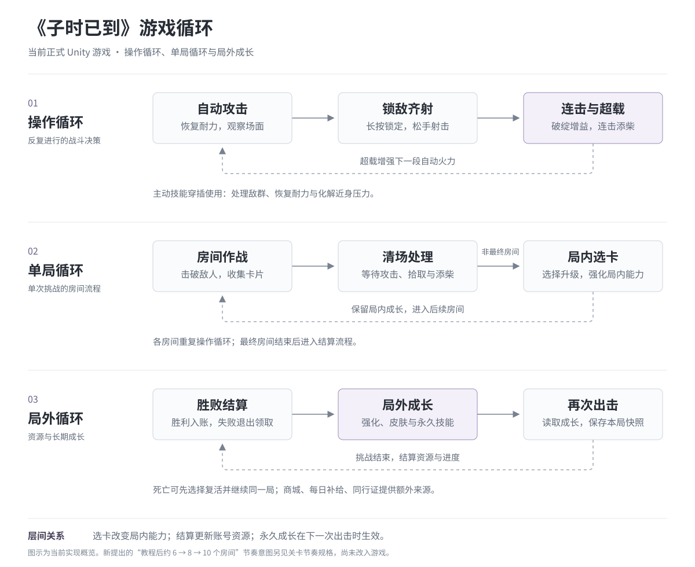

# 系统设计总览

2026-11-13 · 当前正式版协作稿。对象为当前正式 Unity 游戏：自动攻击、手动锁敌齐射、连击超载、主动技能，以及备战和商城。依据本轮工作区源码与配置整理；不是早期原型说明，也不代表已核对线上安装包。本文的机制解释是对现状的归纳，历史动机另见早期设计访谈与新版玩法设计记录。

阅读入口：[战斗](../docs/noon-combat.html) · [局内选卡](../docs/noon-cards.html) · [关卡节奏](../docs/noon-levels.html) · [结算与复活](../docs/noon-settlement.html) · [皮肤、强化、技能与商城](../docs/noon-progression.html) · [功能设计与 AI 交接检查表](../docs/noon-feature-spec.html)。核心体验、受众假设沿用[立项说明](../docs/noon-brief.html)，求职选材沿用[设计案例](../docs/noon-design.html)。

## 1. 游戏简介

《子时已到》是一款竖屏巡夜动作游戏。角色固定站位，平时自动攻击。玩家按住战场进入子弹时间，观察敌方威胁并逐个锁定目标，松手发起齐射。手动命中产生连击，抓住破绽获得更多连击；连击会让自动火力增加，使自动火力进入更高档的超载。玩家还可使用主动技能处理敌群、恢复耐力或化解近身压力。

战斗之外，玩家用结算收益强化攻击、培养部分技能，收集并穿戴整套皮肤，再进入下一星。商城、每日补给与同行证提供额外资源及外观获取入口。

从当前规则可以归纳出三种相互影响的判断：

- **手动介入时机：**长按期间停止发射新的自动弹，获得观察时间、手动锁定和连击收益。
- **齐射释放时机：**多锁目标、等待破绽与及时处理威胁之间有冲突；耐力限制持续长按。
- **技能使用与成长投入：**主动技能受冷却约束，永久成长需要资源且在新出击时形成快照；不能只靠无限长按或不断重进游戏解决压力。

这些是机制所支持的选择，不等于已经证明新玩家都会理解、愿意复玩或愿意付费。

## 2. 游戏循环

[打开清晰版](../assets/game-loops.svg) · [矢量图](../assets/game-loops.svg)。三行按相同方向阅读，虚线表示返回循环；主动技能与外部资源来源放在各行说明中。

**操作循环**持续数秒：自动火力和恢复提供间隙，手动齐射获得连击与添柴收益；超载强化随后一段自动输出。主动技能穿插其中，不承担产热来源。

**单局循环**由多个房间组成：战斗中击破推进并收集卡片，清场后集中选卡，再带着本局能力进入下一个房间；最终房间不发卡，完成后结算。死亡时可先复活同一局，决定结束才领取失败收益。当前正式版本前四星分别包含三个、八个、九个、十个房间，第一星为教程；第五星起以 Boss 房间作为最终房间。

**长期循环**连接星级推进与永久成长：结算资源进入账号，强化和技能升级影响下一局，皮肤按获取与穿戴规则生效。当前只开放服务选定的下一目标星，最终星完成后可重玩；不能将后续设计中的自由重玩奖励写成现行入口。

## 3. 系统功能与关联

| 系统 | 当前规则概要 | 与其他系统的关系 |
| --- | --- | --- |
| 自动攻击 | 常态单发；超载提高频率和弹数；长按、齐射、收尾及部分教学阶段停止发射新弹 | 提供基础输出，给手动操作留下主动介入的价值；不产连击热量 |
| 手动锁敌 | 按住减速并消耗耐力，完成锁定后松手逐发射击；优先处理危险和可完成锁定的破绽 | 处理威胁、贡献连击、触发超载；自动攻击避开正在锁和已锁的目标 |
| 破绽与超载 | 普通手动命中记 1 连击，破绽记 2；释放时固定破绽资格，实际结算计数；连击回落后加热 | 五档火力有升档阈值和退档下限，余热持续衰减；新手需要读懂收益来源 |
| 主动技能 | 屏息、爆破、激光、导弹、冲击波；分别拥有冷却与施放条件 | 屏息恢复耐力并冻结敌方；其余处理不同敌群或压力；不替代手动破解 Boss 原生部件 |
| 局内选卡 | 战斗中收集、非最终房间清场后逐张选择；通常二选一，教程第一个房间单选 | 改变本局耐力、瞄准或主动技能；正常十个房间 14 张，与局外永久等级分别记录 |
| 关卡与教程 | 当前 3 → 8 → 9 → 10 个房间，按星级安排敌潮、Boss 与技能开放 | 房间数量同时影响能力供给、累计失误成本和结算；新提出的约 6 → 8 → 10 个房间梯度另列为意图 |
| 强化 | 备战内四级攻击成长，每级新档收益 +2；消耗金币和强化石，受通关进度限制 | 首四星首通提供对应强化石；攻击写入下一局快照 |
| 皮肤 | D/C/B/A/S 共十五套；支持试穿、整套穿戴、获得途径和一键穿最强 | 当前仍由四部位归属支撑整套外观；穿戴属性受通关与付费外观规则约束 |
| 局外技能 | 六项展示；爆破、穿透、导弹接永久升级；屏息、瞄准、冲击波说明局内成长 | 消耗金币和专属/通用技能材料；永久伤害快照与本局词条共同影响技能效果 |
| 商城与活动 | 每日补给、礼包、灵晶商品、金币兑换及同行证等入口 | 提供资源和外观；开发模拟购买、真实商店交易和账号入账分开验证 |
| 保存与结算 | 胜利入账；失败先预览，退出才领取；复活每局一次 40 灵晶；结算防重复 | 金币、材料、外观归属、同行证经验和星级进度各有去向；续玩与复活保留本局构建 |

### 单局流程与系统交互

| 阶段 | 输入与消耗 | 输出与后续影响 |
| --- | --- | --- |
| 出击 | 当前目标星、体力、穿戴属性、永久攻击与技能 | 保存本局输入与规则；续玩沿用已有输入 |
| 房间战斗 | 自动火力、手动锁敌、破绽、超载与主动技能 | 击破进度、金币收集、待选卡及受伤状态 |
| 房间结束后选卡 | 待选卡、已学技能、当前词条与开放范围 | 本局能力增强；生命延续、耐力补满，热量与冷却保留 |
| 终局 | 胜败、完成房间数量、累计收益、首通/里程碑资格 | 结算资源与进度；失败若复活则继续原局，不先领取 |
| 局外准备 | 已到账资源、解锁资格、已有外观 | 强化、永久技能与穿戴选择影响下一次出击；商城等提供补充来源 |

其中有两条容易混淆的关系：**局内拿到技能会留下“见过该技能”的记录，但本局词条不会变成永久等级；拿到同行证经验会推进等级，但轨道奖励仍需单独领取。** 商城购买也不等于立即改写正在进行中的战斗快照。

## 4. 版本范围与后续设计

这里区分的是**实现范围**，不是否定后续方案。后续方案仍由成长与商城 v2.1维护。

| 项目 | 本轮确认的现行实现 | 已有后续设计，尚不能作为现行实装描述 |
| --- | --- | --- |
| 关卡节奏 | 教程（3 个房间） → 8 个房间 → 9 个房间 → 常规 10 个房间 | Symbol 本次期望：教程后约 6 个房间正常体验与解锁 → 约 8 个房间增压引导升级 → 常规 10 个房间；配套卡数和收益待评审 |
| 强化 | 四级、金币与强化石双消耗、原有旧档承接 | 五十级强化树、四个里程碑、进关战力上限调整 |
| 皮肤 | 十五套预览与穿戴、通关/礼包/同行证途径、现行穿戴属性 | 碎片解锁、升星、拥有加成、新穿戴档位规则 |
| 技能 | 三项永久攻击技能升级、其余局内成长说明 | 六项十级的新培养方案及对应数据调整 |
| 商城 | 现有礼包、充值和兑换；当前模式隐藏旧技能箱及材料直购入口 | 新皮肤箱、新技能箱、广告位及新增商品 |

代码里保留旧服务，不代表当前页面已开放；设计稿已确认方向，也不代表新数据与交易已经接入。本次未修改这两边的游戏行为。

## 5. 功能规格与协作要求

新增或修改功能时，先明确体验目标，再写操作、条件、结果、反馈；同时补足临时状态、异常、保存与配置。已核清的现行规则可作为实现基线；有争议的规则保留评审项，不能因为代码存在就认定其设计已获确认。

战斗、选卡、关卡节奏、结算和局外成长五组规格已按触发、条件、状态、结果、反馈、异常、保存与配置整理。[策划总览](../docs/noon-design.html)用于对外介绍设计思路与迭代依据，专项文档用于协作和实现核对。后续重点是评审新的关卡节奏及其选卡、收益配套，并通过无指导试玩验证。影响玩家选择或系统关系的决定应随迭代记录。

## 6. 规则依据与验证范围

已查正式输入、战斗模型、超载、主动技能、卡片掉落与词条候选、关卡组合与房间切换状态、胜败/复活/收益入账、存档、备战三页、商城入口及永久成长。核对方式为源码、配置与结算算例检查；循环图另做浏览器显示检查。本轮没有启动游戏、重建运行包、验证真实支付或进行真人体验测试。旧文档中的通过记录保留原日期，不能当本轮结果。

