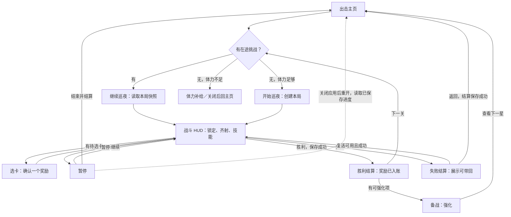
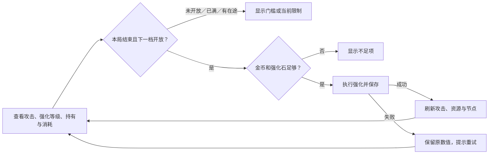
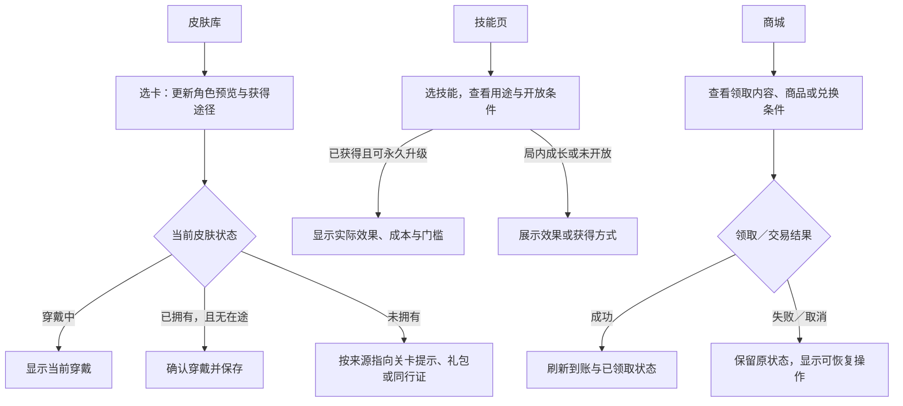

# 界面结构与交互设计

2026-11-13 低保真审阅稿。以 Unity 首星 3 关、当前四级强化和现有备战为底。线框覆盖出击到再次出击，以及皮肤库、技能、商城的页面结构。打开可点击线框 · 当前备战实现证据 · 后续局外规格

## 页面结构

| 区域 | 玩家任务 | 关键页面和状态 | 本轮覆盖 |
| --- | --- | --- | --- |
| 加载／主页 | 找到当前星级、开始或续玩 | 加载、章节与星、资源条、设置、体力补给 | 出击、新开与继续。体力不足、冷启动存档读取留到引擎验收 |
| 战斗 | 读威胁并选择何时松手 | HUD、教学、选卡、暂停、主动技能就绪与冷却 | HUD、选卡、暂停。战斗进度用评审控制切换 |
| 结束与回收 | 知道本次拿到什么，决定下一步 | 胜利、失败、奖励预览、复活可用与用尽 | 胜利、失败与返回，区分到账和预览 |
| 备战 | 提升攻击、穿戴皮肤、看技能 | 强化、皮肤库、技能；门槛、缺资源、成功 | 强化三类状态、皮肤选择与获得途径、技能总览 |
| 商城与活动 | 判断商品与活动价值，完成领取或购买 | 商城三段、每日补给、签到、同行证、礼包、灵晶与兑换 | 先看页面层级，交易弹窗和待接奖池按对应规格另评 |
| 锁定入口 | 识别当前不可用 | 首章底栏末两格 | 作为锁定占位，没有点击动作 |

## 首星交互流程

## 备战与商城交互流程

皮肤试穿阶段只改变预览。商城线框仅评审现有商品层级，礼包、奖池、广告和支付的组合按各自当前规格补分支。真实购买和保存失败要用对应服务或隔离测试状态复核。

## 关键界面状态

| 画面 | 从上到下 | 动作与例外 |
| --- | --- | --- |
| 出击 | 设置／账户，资源条，章节与星级，场景，出击按钮，五格导航 | 首次教学局免费，之后新开消耗 5 体力，续玩沿用已有快照。线框提出加一行下一星攻击对照，具体数值由真实进关规则提供 |
| HUD | 生命、关卡、暂停，耐力，战场与局内反馈，底部技能 | 锁定、破绽、连击和超载靠近作用对象。主动卡热区独立，暂停和选卡覆盖底层输入。失去触点的行为按真实输入验证 |
| 选卡 | 暗幕，候选卡，选中态，确认 | 当前教程第 1 关的爆炸为强制单卡。线框将该状态单列，后续双卡只需沿用清晰差异与确认关系 |
| 胜利／失败 | 结果、关卡进度、资源卡、到账提示、操作 | 胜利用已入账数据。失败先预览，返回才结算。复活显示费用与保留能力。线框的灵晶不足只展示提示，正式购买引导按实际发行服务验收 |
| 强化 | 资源条，角色，攻击总览，节点，持有／需要，页签与主导航 | 四级为现有基线。强化成功同步刷新攻击和余额，进阶门槛可读。线框单列资源不足和未开放示例，未来 50 级树按对应规格另行审阅 |

选卡按可玩实现校对，线框中的「确认」表示选中后应用，正式控件的触发按局内现行规则。线框使用直接切换状态来评审信息，点击战场推进演示不代表实际攻击输入。体力补给、支付失败、保存失败、旧档迁移、皮肤升星及技能细节在正式接入时按对应规格和事务验证。

首通演示使用首测预算中的 175 金币和 1 强化石，强化消耗 120 金币和 1 强化石，攻击从 1 到 3。失败示例的 58 金币取自历史操作记录中的放弃结算，用来说明预览与到账的差异。第一章第二星进入战斗后即完成本次线框的主流程检查。 首测预算 · 配置 · 历史验证

## 美术资源与复用范围

| 页面 | 已有证据 | 待线框通过后补齐 |
| --- | --- | --- |
| 出击／全局导航 | 出击实机截图 · 紫色主页原稿及接入件 | 复用钱包、岛屿、导航和实际文字层。核对下一星信息是否需独立底板 |
| HUD／选卡／暂停 | HUD · 选卡 · 暂停 | 对齐首星当前教学状态，核查目标提示、待选卡层级与主动卡区域 |
| 胜利／失败 | 胜利 · 失败与复活 | 区分奖励已到账和待回收，按两种动作优先级列按钮和内容状态 |
| 备战 | 新版备战实机记录 · 原武器升级分层 | 旧仓库与武器升级弹窗可参考局部组件。新版备战主体按确认线框重排，现有紫色备战主体缺分件 |
| 商城／活动 | 23 张分层源稿与总览 · 历史 Figma 界面快照 | 第二批先核对入口、可购买／可领取／已领／失败状态，再列可复用卡、窗口和缺件 |

23 张 PSD 基于 2026-11-09 的 Unity 取样，是后续比对与可编辑素材入口。备战以后续独立实机记录及源码为准。新版紫色商城、备战、补给主体只有局部素材或整页参考，补做时对照真实 PSD 图层及缺件表。

## 界面验证要求

以 720×1334 为基准，复看 720×1281、720×1558 模拟画幅及项目实际中英文。记录顶部资源、按钮命中与战斗输入遮挡、短屏结算和长屏暗幕。用新档、有进行中挑战及一份带历史成长的旧档核对结算和强化事务。触屏、音效听感、发行服务另按实际运行条件登记。 现有验证入口
